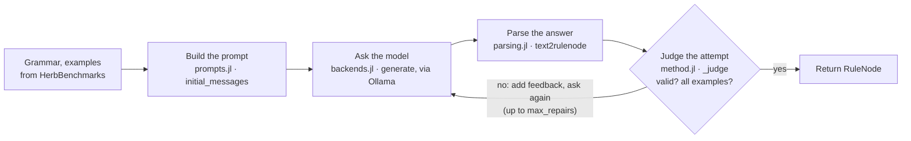

# LLM baseline: code reading guide

How to approach reading the code of `Garden.LLMBaseline`. For how to *use* the baseline, see [README.md](README.md).

## Big picture

The baseline is about 690 lines of Julia in four files, and one function, `llm_synth`, ties them together. It turns a grammar and a `Problem` into a prompt, asks an Ollama model for a program, and parses the answer back into a `RuleNode` of the grammar. An optional interpreter then checks each candidate on the examples.



Each box is one file. `llm_synth` runs this loop once per sample (`num_samples`), each in a fresh conversation; a parse error also counts as a "no" and gets feedback. When every sample and repair is used up, the valid program with the highest fitness is returned.

Everything lives in `Garden.jl/src/llm_baseline/`. The module is `Garden.LLMBaseline`.

| File | Lines | What it holds | Key names |
| --- | --- | --- | --- |
| [`method.jl`](method.jl) | 156 | Module header, the main loop, the result type | `llm_synth`, `_judge`, `evaluate`, `Attempt` |
| [`backends.jl`](backends.jl) | 132 | Talking to the model | `AbstractLanguageModel`, `generate`, `OllamaModel`, `FunctionModel`, `RECOMMENDED_MODELS` |
| [`prompts.jl`](prompts.jl) | 196 | Building the messages the model sees | `PromptTemplate`, `initial_messages`, `feedback_message`, `format_grammar`, `format_value` |
| [`parsing.jl`](parsing.jl) | 202 | From answer text to `RuleNode` | `text2rulenode`, `extract_code`, `parse_program`, `expr2rulenode_typed` |
| [`test/test_llm_baseline.jl`](../../test/test_llm_baseline.jl) | 187 | Offline tests with scripted models | — |
| [`test/test_llm_baseline_live.jl`](../../test/test_llm_baseline_live.jl) | 94 | Opt-in tests against a real model | — |

The user-facing documentation is [README.md](README.md). This guide is about the code behind it. Line numbers below refer to the files as of this guide's commit.

## Reading order

Read top-down from `llm_synth`, then the three helper files in the order data flows through them, and leave `parsing.jl` for last. It is the densest file and the one most worth reading with a REPL open. Plan on about an hour and a half for a first pass.

1. **Skim the README and run the offline tests** (15 min). Knowing what the code is supposed to do makes the rest faster to read. Run `Pkg.test()` in the Garden.jl folder.
2. **`method.jl`: `llm_synth`, `_judge` and `evaluate`** (15 min). This is the spine: every other file is called from here.
3. **`backends.jl`** (10 min). Short and self-contained: one interface, two implementations.
4. **`prompts.jl`** (20 min). How the grammar and examples become text, and where the inductive-only guarantee is enforced.
5. **`parsing.jl`** (30 min). How answer text becomes a `RuleNode`. Read it alongside the REPL exercises below.
6. **The tests** (15 min). They pin down the edge cases each file handles, so they double as a specification.

Inside each file, the public functions come first and the helpers (names starting with `_`) after them. You can skip a helper until a public function calls it.

## Step 1: `method.jl`, the main loop

`llm_synth` (line 77) is two nested loops: an outer loop over independent samples, each a fresh conversation, and an inner loop over repair rounds within one conversation. Each turn of the inner loop makes one model call and turns the answer into an `Attempt` with `_judge` (line 120).

Read `llm_synth` in this order:

1. **Argument checks** (three lines). Everything else is plain loops.
2. **The sample loop.** Each sample builds the first prompt with `initial_messages` and gets its own seed, `seed + sample - 1`.
3. **The repair loop.** It returns at once when an answer is good enough: a valid program that solves every example, or, without an interpreter, any valid program. Otherwise the answer and a feedback message from `feedback_message` are appended to the conversation and the model is asked again.
4. **Fallback.** When everything is used up, the valid program with the highest fitness is returned, or `nothing` if no answer parsed. The function always returns `(program, attempts)`.

`_judge` parses the answer with `text2rulenode`. A `GrammarParseError` becomes the attempt's `error`; any other exception is a bug and is rethrown. With an interpreter, `evaluate` (line 140) runs the program on every example. An interpreter exception counts as a failed example, and the exception is kept as that example's output so the feedback can show it.

There are no other error paths. If Ollama cannot be reached, `generate` throws and `llm_synth` stops: in a benchmark run, every later call would fail too.

`Attempt` (line 28) is the only result type: one model call with its full answer, the extracted code, the parsed program or the reason it could not be parsed, fitness, failing examples and time. When a result looks wrong, the attempts are the first place to look. Run with `JULIA_DEBUG=Garden` to log each one as it happens.

## Step 2: `backends.jl`, talking to the model

The whole model interface is one function: `generate(model, messages; seed) -> String`. Nothing else in the baseline knows how a model is reached, so this file can be read in isolation.

- **`ChatMessage`** (line 13) is a role and a text. A conversation is a `Vector{ChatMessage}`.
- **`OllamaModel`** (line 49) holds the model tag, the server, the `think` setting, a dictionary of Ollama `options` and a timeout. Its `generate` (line 58) adds `"num_ctx" => 32768` unless the options set it, adds the seed, and posts to Ollama's native `/api/chat` endpoint. The native endpoint is used rather than Ollama's OpenAI-style one because only the native one accepts `num_ctx`.
- **`FunctionModel`** (line 78) wraps any Julia function from messages to text. The offline tests use it to script answers. It ignores the seed.
- **`_post_json`** (line 84) is the only network code. It uses the `Downloads` standard library with `throw = false`, so a refused connection and an HTTP error both become an `error(...)` with a readable message.
- **`RECOMMENDED_MODELS`** (line 105) and **`DEFAULT_OLLAMA_MODEL`** (line 132) are data only.

When reading, ask: what would a new backend need? Only a subtype of `AbstractLanguageModel` and a `generate` method.

## Step 3: `prompts.jl`, what the model sees

A prompting strategy is any `AbstractPrompt` (line 15) with two methods: `initial_messages` builds the first conversation and `feedback_message` writes a repair message from an `Attempt`. `PromptTemplate` (line 71) is the only implementation: four texts, the system and user messages and two feedback messages.

The inductive-only guarantee is structural, and this is the point to understand first. `initial_messages` (line 83) is given the grammar, the start symbol and the examples, never the `Problem`. The problem's name therefore cannot reach the prompt, whatever template is used. The second safeguard is `format_value` (line 160), which prints values without the name of the module that defines their type, so a type like `StringState` does not reveal which benchmark module it comes from.

Read in this order:

1. **The default texts** (lines 17–56): `DEFAULT_SYSTEM_PROMPT`, `DEFAULT_USER_PROMPT`, `DEFAULT_PARSE_FEEDBACK` and `DEFAULT_WRONG_FEEDBACK`. These are the prompt as the model reads it.
2. **`initial_messages`**, **`feedback_message`** (line 94) and **`fill_template`** (line 105). Templates use `{{key}}` slots: `{{grammar}}`, `{{start}}` and `{{examples}}` for the first message, `{{message}}` and `{{failures}}` for feedback. A slot with no value is left in the text unchanged.
3. **`format_grammar`** (line 119) and **`rule_string`** (line 134). One line per nonterminal, the start symbol first, duplicate productions shown once. `_rs` gives blocks and conditionals a one-line form, `(a; b)` and `(c ? a : b)`, because Julia's own printer spreads them over several lines.
4. **`format_examples`** (line 169), **`format_failures`** (line 177) and **`_labelled`** (line 192). A value whose printed form spans several lines, such as a robot grid, is put on indented lines of its own below its label.

`rule_string` matters beyond prompts: the parser uses it in error messages, and the round-trip tests use it to print programs. The syntax the model is shown is the syntax the parser accepts back.

## Step 4: `parsing.jl`, from text to `RuleNode`

The parser does not have its own grammar of Julia syntax. It lets Julia's parser build an expression, then derives that expression from the start symbol by matching it against the grammar's productions, top-down. It was written instead of using `HerbGrammar.expr2rulenode` because that function only handles plain function calls, and benchmark grammars also have blocks, infix operators, conditionals and literal constants.

`text2rulenode` (line 26) runs three stages in order:

1. **`extract_code`** (line 39) picks the program out of the answer: the last fenced block, also when its closing fence is missing, else the last inline `code` span. Reasoning traces in `<think>…</think>` are removed first.
2. **`parse_program`** (line 56) calls `Meta.parseall`, turns syntax errors into a `GrammarParseError`, and removes wrappers with `_unwrap` (line 69): `function f(...) … end`, `return …` and `x = …`. An assignment is kept when the grammar itself contains one, as in the ARC grammar. `normalize_expr` (line 86) puts every expression into one canonical form: no line numbers, no one-statement blocks, `elseif` as `if`, and `a; b` on one line (which Julia parses as `:toplevel`) as a block. The same function is applied to the grammar's productions, so both sides of every comparison are in the same form.
3. **`expr2rulenode_typed`** (line 119) does the derivation.

The derivation is the part to read slowly. `_Matcher` (line 98) holds the normalised productions, the set of nonterminals, the derivations in progress and a list of failures. Two functions call each other:

- **`_derive(m, ex, type)`** (line 127) answers "can `ex` be derived from nonterminal `type`?". It tries the productions of `type` in grammar order and returns the first success as a `RuleNode`. The in-progress set stops infinite loops through unit productions like `A = B`, `B = A`.
- **`_unify!(m, pat, ex, children)`** (line 148) walks one production's pattern and the expression side by side. A nonterminal in the pattern calls `_derive` on the matching sub-expression and appends the child. An `Expr` must have the same head and number of arguments. Anything else is a literal and goes through `_literal_equal` (line 179), which treats `1` and `0x01` as equal but `true` and `1` as different.

Children are collected left to right, depth first, which is the order `rulenode2expr` reads them back. That is why the returned `RuleNode` prints back as the same program.

`_reassociate` (line 167) makes model output fit binary productions: it re-nests a flat sequence `a; b; c` as `a; (b; c)` and a chain `a + b + c` as `(a + b) + c` before comparing. Without it, most multi-statement answers for the string and robot grammars would be rejected.

Error messages come from `_same_shape` (line 185) and `_explain_failure` (line 194). A failure is recorded only when no production of the nonterminal even has the right top-level form. The message then names the smallest such sub-expression, so `x + 3` reports `3`, not the whole program.

One behaviour to keep in mind: when a program can be derived in more than one way, the first production in grammar order wins. Duplicate rules such as the two `ntInt = 1` lines in the SyGuS grammars are harmless for that reason.

## Step 5: the tests as a specification

The offline tests use two toy grammars, `arith` (integers, `+`, `*`, a conditional) and `seq` (a statement-sequence language like the string and robot benchmarks). Each testset pins down the behaviour of one file, so read each one after the file it covers.

| Testset | Pins down | Read after |
| --- | --- | --- |
| `extract_code` | Which code block wins; reasoning traces and cut-off answers | `parsing.jl` stage 1 |
| `parsing into the grammar` | Accepted surface syntax; where errors point | `parsing.jl` |
| `round trip on all small programs` | Every program up to depth 4 (at most 300 per grammar) prints and parses back to itself | `rule_string` + the parser |
| `prompt is purely inductive` | No problem name or module name in the prompt; string values printed unchanged; grammar layout | `prompts.jl` |
| `llm_synth` | One-shot success, repairs, best-of-samples, no interpreter, nothing parseable, custom prompts | `method.jl` |
| `Ollama backend` | Settings are stored; an unreachable server gives a clear error | `backends.jl` |

The helper to understand is `scripted(replies)` at the top of `test_llm_baseline.jl`. It returns a `FunctionModel` that answers with the given replies in order, plus a list of every conversation the model was shown. The `llm_synth` tests check both what was returned and what the model saw, for example that the second conversation ends with a feedback message about a grammar error.

`test_llm_baseline_live.jl` is skipped unless `GARDEN_LLM_TESTS=true`. It has the same shape against a real Ollama model, but it only expects the model to solve `x + 1`; for harder tasks it only checks that the pipeline returns a valid program or `nothing`.

## Hands-on exercises

These five exercises make each file's behaviour visible in a REPL. The first four need no Ollama. Run them in the environment from the README's installation section (Garden.jl plus HerbBenchmarks.jl), starting with:

```julia
using Herb, HerbBenchmarks
import Garden.LLMBaseline as L
import HerbBenchmarks.String_transformations_2020 as ST

pair = get_problem_grammar_pair(ST, "100")
g = pair.grammar
```

**1. See exactly what the model sees** (goes with `prompts.jl`). Note the grammar layout, the `(Operation; Sequence)` production, and `StringState(...)` printed without its module.

```julia
msgs = L.initial_messages(L.DEFAULT_PROMPT, g, :Start, pair.problem.spec[1:2])
foreach(m -> println("[", m.role, "]\n", m.content, "\n"), msgs)
```

**2. Parse an answer, then a wrong one** (goes with `parsing.jl`). Three statements on separate lines come back as `1{3{4{6},3{4{6},2{4{10}}}}}`, the right-nested `Sequence`. The second call fails with `jump()` cannot be derived from nonterminal `Transformation`.

````julia
rn = L.text2rulenode("```julia\nmoveRight()\nmoveRight()\ndrop()\n```", g, :Start)
rulenode2expr(rn, g)
L.text2rulenode("```julia\nmoveRight(); jump()\n```", g, :Start)
````

**3. See where a derivation fails** (goes with `_derive` and `_explain_failure`). `m.failures` lists every (sub-expression, nonterminal) pair whose top-level form matched no production. The error message picks the smallest one, `jump()` as a `Transformation`.

```julia
expr = L.parse_program("moveRight(); jump()", g)
m = L._Matcher(g)
L._derive(m, expr, :Start)   # nothing
foreach(((ex, t),) -> println(t, ": ", L.rule_string(ex)), m.failures)
```

**4. Spy on the main loop** (goes with `method.jl`). A `FunctionModel` that prints what it receives shows the repair loop: the second call sees 4 messages, ending with the "wrong on these examples" feedback.

````julia
spy = L.FunctionModel(messages -> begin
    println("--- model sees ", length(messages), " messages; last one:\n", messages[end].content)
    "```julia\nmoveRight()\n```"
end)
program, attempts = L.llm_synth(g, :Start, pair.problem; model = spy, interpret = ST.interpret, max_repairs = 1)
attempts
````

**5. Run a real model** (goes with `backends.jl`; needs Ollama and a pulled model). Compare `attempts[1].response` with `.code` to see what `extract_code` threw away.

```julia
program, attempts = L.llm_synth(g, :Start, pair.problem;
    model = L.OllamaModel("qwen3.5:4b"), interpret = ST.interpret)
attempts[1].response
```

## Where to change things, and known limitations

Most changes touch one file, because the files only meet through `generate`, `initial_messages` / `feedback_message` and `text2rulenode`.

| To change | Go to | Without editing the package? |
| --- | --- | --- |
| Wording of the prompt or feedback | `DEFAULT_*` constants in `prompts.jl` | Yes: `PromptTemplate(user = …)` |
| How grammars or values are printed, or the prompting strategy (few-shot, two-stage) | New `AbstractPrompt` subtype; reuse `format_grammar`, `format_examples`, `fill_template` | Yes: define it in your own code |
| Model or Ollama settings | `OllamaModel` keywords and `options` | Yes |
| A new model server | New `AbstractLanguageModel` + `generate` in `backends.jl` | Yes, but it belongs in the package |
| Accepted answer syntax | `normalize_expr`, `_reassociate`, `_unwrap` in `parsing.jl` | No |
| How candidates are ranked or when to stop | `llm_synth` in `method.jl` | No |

After changing the parser, the round-trip testset is the one to watch: it checks that every small program still prints and parses back to itself.

Known limitations, in rough order of how likely they are to matter:

- **Not yet run against a real model.** Everything was tested with scripted models and a fake Ollama server. The first live run may show answer formats the parser does not expect yet.
- **Constants outside the grammar are rejected, not repaired.** SyGuS grammars offer only a few integers, so `substr_cvc(_arg_1, 5, 3)` fails even if `5` could be built as `1 + 1 + 1 + 1 + 1`. Only the repair feedback helps the model here.
- **Samples run one after another.** `num_samples = 10` takes ten times as long as one sample.
- **`Robots_2020` needs a custom interpreter.** Its inputs are stored under `:_arg_1_`, so its own `interpret` fails on every example (see the README).
