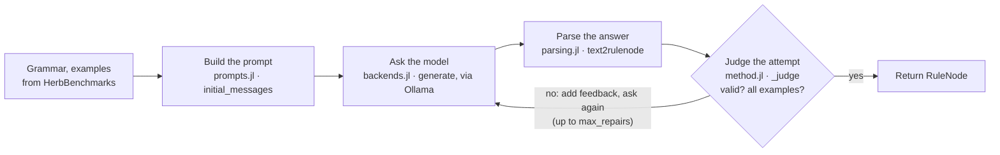

# LLM baseline: code reading guide

How to approach reading, maintaining and extending the code of `Garden.LLMBaseline`. For how to *use* the baseline, see [README.md](README.md).

## Big picture

The baseline is about 800 lines of Julia in six files, and one function, `llm_synth`, ties them together. It turns a grammar and a `Problem` into a prompt, asks an Ollama model for a program, and parses the answer back into a `RuleNode` of the grammar. An optional interpreter then checks each candidate on the examples.



`llm_synth` runs this loop once per sample (`num_samples`), each in a fresh conversation; a parse error also counts as a "no" and gets feedback. When every sample and repair is used up, the valid program with the highest fitness is returned.

Everything lives in `Garden.jl/src/llm_baseline/`. The module is `Garden.LLMBaseline`. `method.jl` is the module file and includes the others in dependency order: each file uses only the files before it.

| File | What it holds | Key names |
| --- | --- | --- |
| [`types.jl`](types.jl) | The shared types and the two extension interfaces | `ChatMessage`, `Attempt`, `GrammarParseError`, `AbstractLanguageModel` + `generate`, `AbstractPrompt` + `initial_messages` / `feedback_message` |
| [`syntax.jl`](syntax.jl) | Expression helpers used by both prompts and parser; all direct access to grammar fields | `normalize_expr`, `rule_string`, `_rules`, `_productions` |
| [`backends.jl`](backends.jl) | The model implementations | `OllamaModel`, `FunctionModel`, `RECOMMENDED_MODELS` |
| [`prompts.jl`](prompts.jl) | What the model sees | `PromptTemplate`, `format_grammar`, `format_examples`, `format_value` |
| [`parsing.jl`](parsing.jl) | From answer text to `RuleNode` | `text2rulenode`, `extract_code`, `parse_program`, `expr2rulenode_typed` |
| [`method.jl`](method.jl) | The module header and the main loop | `llm_synth`, `_run_sample!`, `_is_solution`, `_judge`, `evaluate` |

The tests are in `test/`: [`test_llm_baseline.jl`](../../test/test_llm_baseline.jl) (offline, scripted models), [`test_llm_baseline_live.jl`](../../test/test_llm_baseline_live.jl) (opt-in, a real model) and [`test_llm_baseline_benchmarks.jl`](../../test/test_llm_baseline_benchmarks.jl) (opt-in, every HerbBenchmarks benchmark).

## Reading order

Read `types.jl` first, because every other file is written in terms of it. Then follow `llm_synth` top-down, and leave `parsing.jl` for last: it is the densest file and the one most worth reading with a REPL open. Plan on about an hour and a half for a first pass.

1. **Skim the README and run the offline tests** (15 min). Run `Pkg.test()` in the Garden.jl folder.
2. **`types.jl`** (10 min). The vocabulary: what a message, an attempt, a model and a prompt are.
3. **`method.jl`** (15 min). The spine: every other file is called from here.
4. **`backends.jl`** (10 min). Short and self-contained.
5. **`syntax.jl` and `prompts.jl`** (20 min). How the grammar and examples become text, and where the inductive-only guarantee is enforced.
6. **`parsing.jl`** (30 min). How answer text becomes a `RuleNode`. Read it alongside the REPL exercises below.
7. **The tests** (15 min). They pin down the edge cases each file handles, so they double as a specification.

Inside each file, the public functions come first and the helpers (names starting with `_`) after them. You can skip a helper until a public function calls it.

## Step 1: `types.jl`, the vocabulary

This file has no logic. It defines the data that flows between the other files and the two places where the baseline is meant to be extended:

- **Models:** a subtype of `AbstractLanguageModel` with a `generate(model, messages; seed)` method that returns the answer text.
- **Prompts:** a subtype of `AbstractPrompt` with `initial_messages(prompt, grammar, start, examples)` and `feedback_message(prompt, attempt)`.

`Attempt` is the record of one model call: the full answer, the extracted code, the parsed program or the reason it could not be parsed, its fitness and failing examples, and the time taken. It is the only result type, and it is also what `feedback_message` receives, so a custom prompt can react to anything about a failed answer.

## Step 2: `method.jl`, the main loop

`llm_synth` checks its arguments, bundles what stays fixed during the call into a `_Setup` (grammar, start symbol, examples, interpreter, comparison), and runs one conversation per sample until one finds a solution. Each piece has its own small function:

- **`_run_sample!`** runs one conversation: build the first prompt, then ask, judge and give feedback, up to `max_repairs` times. It appends every attempt to the shared list and returns the solution, if any.
- **`_is_solution`** is the stopping rule: a valid program that solves every example, or, without an interpreter, any valid program.
- **`_best_program`** is the final pick when nothing was a solution: the valid program with the highest fitness.
- **`_judge`** turns one answer into an `Attempt`: parse it with `text2rulenode` (a `GrammarParseError` becomes the attempt's `error`; any other exception is a bug and is rethrown), then score it with `evaluate`.
- **`evaluate`** runs `interpret(program, example.in)` on every example, the same convention as Probe. An interpreter exception counts as a failed example and is kept as that example's output, so the feedback can show it.

There are no other error paths. If Ollama cannot be reached, `generate` throws and `llm_synth` stops: in a benchmark run, every later call would fail too. Run with `JULIA_DEBUG=Garden` to log each attempt as it happens.

A new search strategy (say, samples in parallel, or stopping at a fitness threshold) changes `llm_synth`'s loop and `_is_solution`; `_run_sample!` and `_judge` can stay as they are.

## Step 3: `backends.jl`, talking to the model

- **`OllamaModel`** holds the model tag, the server, the `think` setting, a dictionary of Ollama `options` and a timeout. Its `generate` adds `"num_ctx" => 32768` unless the options set it, adds the seed, and posts to Ollama's native `/api/chat` endpoint. The native endpoint is used rather than Ollama's OpenAI-style one because only the native one accepts `num_ctx`.
- **`FunctionModel`** wraps any Julia function from messages to text. The offline tests use it to script answers. It ignores the seed.
- **`_post_json`** is the only network code. It uses the `Downloads` standard library with `throw = false`, so a refused connection and an HTTP error both become an `error(...)` with a readable message.
- **`RECOMMENDED_MODELS`** and **`DEFAULT_OLLAMA_MODEL`** are data only.

A new model server is a new struct and a `generate` method in this file; nothing else changes.

## Step 4: `syntax.jl` and `prompts.jl`, what the model sees

`syntax.jl` holds what the prompt and the parser must agree on. `normalize_expr` puts an expression into one canonical form: no line numbers, no one-statement blocks, `elseif` as `if`, and `a; b` on one line (which Julia parses as `:toplevel`) as a block. `rule_string` prints an expression on one line, with blocks as `(a; b)` and conditionals as `(c ? a : b)`, and brackets around nested infix calls so that `a + (b + c)` keeps its shape. The syntax the model is shown is the syntax the parser accepts back.

The file also holds the only code that reads the grammar's fields: `_rules`, `_productions` and `_nonterminals_in_order`. HerbGrammar exports `nonterminals(grammar)`, which the code uses where it can, but has no public accessor for a grammar's rules. If Herb changes its grammar type, these three lines are the place to update.

In `prompts.jl`, `PromptTemplate` is the default `AbstractPrompt`: four texts (system, user and two feedback messages) with `{{key}}` slots filled by `fill_template`. Read the `DEFAULT_*` texts first; they are the prompt as the model reads it.

The inductive-only guarantee rests on two things, and this is the point to understand:

1. **`initial_messages` is never given the `Problem`**, so the problem's name cannot reach the prompt, whatever prompt type is used.
2. **`format_value` removes module names** from a printed value. `_modules_in` collects the module of every non-Base type in the value, including types nested in containers and struct fields, and `_strip_module_names` removes each module path from the printed text. Error messages in feedback go through `_error_line`, which keeps only the first line (later lines of a `MethodError` list file paths) and removes module names the same way.

`format_examples` and `format_failures` lay values out with `_labelled`, which puts a value that spans several lines, such as a robot grid, on indented lines below its label.

## Step 5: `parsing.jl`, from text to `RuleNode`

The parser does not have its own grammar of Julia syntax. It lets Julia's parser build an expression, then derives that expression from the start symbol by matching it against the grammar's productions, top-down. It was written instead of using `HerbGrammar.expr2rulenode` because that function only handles plain function calls, and benchmark grammars also have blocks, infix operators, conditionals and literal constants.

`text2rulenode` runs three stages:

1. **`extract_code`** picks the program out of the answer: the last fenced block, also when its closing fence is missing, else the last inline `code` span. Reasoning traces in `<think>…</think>` are removed first.
2. **`parse_program`** calls `Meta.parseall`, turns syntax errors into a `GrammarParseError`, normalises the expression, and removes wrappers with `_unwrap`: `function f(...) … end`, `return …` and `x = …`. An assignment is kept when the grammar itself contains one, as in the ARC grammar.
3. **`expr2rulenode_typed`** does the derivation.

The derivation is the part to read slowly. `_Matcher` holds the normalised productions, the set of nonterminals, the derivations in progress and a list of failures. Two functions call each other:

- **`_derive(m, ex, type)`** answers "can `ex` be derived from nonterminal `type`?". It tries the productions of `type` in grammar order and returns the first success as a `RuleNode`. The in-progress set stops infinite loops through unit productions like `A = B`, `B = A`. Its comment states the one performance assumption in the code: there is no memoisation, which is fine for small answers but would be the first thing to add if parsing ever gets slow.
- **`_unify!(m, pat, ex, children)`** walks one production's pattern and the expression side by side. A nonterminal in the pattern calls `_derive` on the matching sub-expression and appends the child. An `Expr` must have the same head and number of arguments. Anything else is a literal and goes through `_literal_equal`, which treats `1` and `0x01` as equal but `true` and `1` as different.

Children are collected left to right, depth first, which is the order `rulenode2expr` reads them back, so the returned `RuleNode` prints back as the same program.

`_reassociate` makes model output fit binary productions: it re-nests a flat sequence `a; b; c` as `a; (b; c)` and a chain `a + b + c` as `(a + b) + c`. Error messages come from `_same_shape` and `_explain_failure`: a failure is recorded only when no production of the nonterminal even has the right top-level form, and the message names the smallest such sub-expression, so `x + 3` reports `3`, not the whole program. When a program can be derived in more than one way, the first production in grammar order wins.

## Step 6: the tests as a specification

The offline tests use two toy grammars, `arith` (integers, `+`, `*`, a conditional) and `seq` (a statement-sequence language like the string and robot benchmarks).

| Testset | Pins down | Read after |
| --- | --- | --- |
| `extract_code` | Which code block wins; reasoning traces and cut-off answers | `parsing.jl` |
| `parsing into the grammar` | Accepted surface syntax; where errors point | `parsing.jl` |
| `round trip on all small programs` | Every program up to depth 4 (at most 300 per grammar) prints and parses back to itself, including nested infix calls | `syntax.jl` + the parser |
| `prompt is purely inductive` | No problem name or module name in prompts and feedback, also for nested types and error messages | `prompts.jl` |
| `llm_synth` | One-shot success, repairs, best-of-samples, no interpreter, nothing parseable, custom templates | `method.jl` |
| `custom prompt type` | A minimal `AbstractPrompt` subtype (`TersePrompt`) works end to end | `types.jl` |
| `Ollama backend` | Settings are stored; an unreachable server gives a clear error | `backends.jl` |

`scripted(replies)` at the top of the file returns a `FunctionModel` that answers with the given replies in order, plus a list of every conversation the model was shown, so tests check both what was returned and what the model saw.

The two opt-in files are skipped unless an environment variable is set:

- `test_llm_baseline_live.jl` (`GARDEN_LLM_TESTS=true`) runs the same kind of checks against a real Ollama model.
- `test_llm_baseline_benchmarks.jl` (`GARDEN_BENCHMARK_TESTS=true`) checks every HerbBenchmarks benchmark: the parser round trip on random programs, no module or problem names in prompts and feedback, and that each benchmark's interpreter works with the `interpret(program, input)` convention. It is the strongest regression check for the parser and the formatting; run it after changing either. It runs from the README's experiment environment, because HerbBenchmarks is not a registered package.

## Hands-on exercises

These five exercises make each file's behaviour visible in a REPL. The first four need no Ollama. Run them in the environment from the README's installation section (Garden.jl plus HerbBenchmarks.jl), starting with:

```julia
using Herb, HerbBenchmarks
import Garden.LLMBaseline as L
import HerbBenchmarks.String_transformations_2020 as ST

pair = get_problem_grammar_pair(ST, "100")
g = pair.grammar
interpret = (p, input) -> ST.interpret(p, input[:_arg_1])
```

**1. See exactly what the model sees** (goes with `prompts.jl`). Note the grammar layout, the `(Operation; Sequence)` production, and `StringState(...)` printed without its module.

```julia
msgs = L.initial_messages(L.DEFAULT_PROMPT, g, :Start, pair.problem.spec[1:2])
foreach(m -> println("[", m.role, "]\n", m.content, "\n"), msgs)
```

**2. Parse an answer, then a wrong one** (goes with `parsing.jl`). Three statements on separate lines come back as `1{3{4{6},3{4{6},2{4{10}}}}}`, the right-nested `Sequence`. The second call fails with `jump()` cannot be derived from nonterminal `Transformation`.

````julia
rn = L.text2rulenode("```julia\nmoveRight()\nmoveRight()\ndrop()\n```", g, :Start)
rulenode2expr(rn, g)
L.text2rulenode("```julia\nmoveRight(); jump()\n```", g, :Start)
````

**3. See where a derivation fails** (goes with `_derive` and `_explain_failure`). `m.failures` lists every (sub-expression, nonterminal) pair whose top-level form matched no production. The error message picks the smallest one, `jump()` as a `Transformation`.

```julia
expr = L.parse_program("moveRight(); jump()", g)
m = L._Matcher(g)
L._derive(m, expr, :Start)   # nothing
foreach(((ex, t),) -> println(t, ": ", L.rule_string(ex)), m.failures)
```

**4. Spy on the main loop** (goes with `method.jl`). A `FunctionModel` that prints what it receives shows the repair loop: the second call sees 4 messages, ending with the "wrong on these examples" feedback.

````julia
spy = L.FunctionModel(messages -> begin
    println("--- model sees ", length(messages), " messages; last one:\n", messages[end].content)
    "```julia\nmoveRight()\n```"
end)
program, attempts = L.llm_synth(g, :Start, pair.problem; model = spy, interpret, max_repairs = 1)
attempts
````

**5. Run a real model** (goes with `backends.jl`; needs Ollama and a pulled model). Compare `attempts[1].response` with `.code` to see what `extract_code` threw away.

```julia
program, attempts = L.llm_synth(g, :Start, pair.problem;
    model = L.OllamaModel("qwen3.5:4b"), interpret)
attempts[1].response
```

## Where to change things, and known limitations

Most changes touch one file, because the files only meet through the interfaces in `types.jl` and through `text2rulenode`.

| To change | Go to | Without editing the package? |
| --- | --- | --- |
| Wording of the prompt or feedback | `DEFAULT_*` constants in `prompts.jl` | Yes: `PromptTemplate(user = …)` |
| How grammars or values are printed, or the prompting strategy (few-shot, two-stage) | New `AbstractPrompt` subtype; see `TersePrompt` in the tests | Yes: define it in your own code |
| Model or Ollama settings | `OllamaModel` keywords and `options` | Yes |
| A new model server | New `AbstractLanguageModel` subtype + `generate` in `backends.jl` | Yes, but it belongs in the package |
| Accepted answer syntax | `normalize_expr` (`syntax.jl`), `_reassociate`, `_unwrap` (`parsing.jl`) | No |
| When to stop, or which program to return | `_is_solution`, `_best_program` in `method.jl` | No |
| Support for a new Herb grammar type | `_rules`, `_productions`, `_nonterminals_in_order` in `syntax.jl` | No |

After changing the parser or the formatting, run the benchmark tests as well as the offline ones.

Known limitations, in rough order of how likely they are to matter:

- **Not yet run against a real model.** Everything was tested with scripted models and a fake Ollama server. The first live run may show answer formats the parser does not expect yet.
- **Constants outside the grammar are rejected, not repaired.** SyGuS grammars offer only a few integers, so `substr_cvc(_arg_1, 5, 3)` fails even if `5` could be built as `1 + 1 + 1 + 1 + 1`. Only the repair feedback helps the model here.
- **Samples run one after another.** `num_samples = 10` takes ten times as long as one sample.
- **Stateful benchmark interpreters need a wrapper.** The string, pixel and robot interpreters take a state, not the input `Dict`; the README lists the one-line wrappers.
