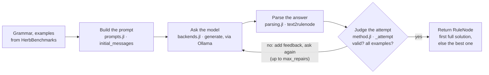

# LLM baseline: code reading guide

How to approach reading the code of `Garden.LLMBaseline`. For how to *use* the baseline, see [README.md](README.md).

## Big picture

The baseline is about 1,000 lines of Julia in four files, and one function, `llm_synth`, ties them together. It turns a grammar and a `Problem` into a prompt, asks an Ollama model for a program, and parses the answer back into a `RuleNode` of the grammar. An optional interpreter then checks each candidate on the examples.



Each box is one file. `llm_synth` runs this loop once per sample (`num_samples`), each in a fresh conversation; a parse error also counts as a "no" and gets feedback.

Everything lives in `Garden.jl/src/llm_baseline/`. The module is `Garden.LLMBaseline`.

| File | Lines | What it holds | Key names |
| --- | --- | --- | --- |
| [`method.jl`](method.jl) | 247 | Module header, the main loop, result types | `llm_synth`, `_attempt`, `Attempt`, `LLMSynthLog` |
| [`backends.jl`](backends.jl) | 194 | Talking to the model | `AbstractLanguageModel`, `generate`, `OllamaModel`, `FunctionModel`, `RECOMMENDED_MODELS` |
| [`prompts.jl`](prompts.jl) | 301 | Building the messages the model sees | `PromptTemplate`, `initial_messages`, `feedback_message`, `format_grammar`, `format_value` |
| [`parsing.jl`](parsing.jl) | 284 | From answer text to `RuleNode` | `text2rulenode`, `extract_code`, `parse_program`, `expr2rulenode_typed` |
| [`test/test_llm_baseline.jl`](../../test/test_llm_baseline.jl) | 185 | Offline tests with scripted models | — |
| [`test/test_llm_baseline_live.jl`](../../test/test_llm_baseline_live.jl) | 94 | Opt-in tests against a real model | — |

The user-facing documentation is [README.md](README.md). This guide is about the code behind it. Line numbers below refer to the files as of this guide's commit.

## Reading order

Read top-down from `llm_synth`, then the three helper files in the order data flows through them, and leave `parsing.jl` for last. It is the densest file and the one most worth reading with a REPL open. Plan on about two hours for a first pass.

1. **Skim the README and run the offline tests** (15 min). Knowing what the code is supposed to do makes the rest faster to read. Run `Pkg.test()` in the Garden.jl folder.
2. **`method.jl`: `llm_synth` and `_attempt`** (20 min). This is the spine: every other file is called from here.
3. **`backends.jl`** (10 min). Short and self-contained: one interface, two implementations.
4. **`prompts.jl`** (25 min). How the grammar and examples become text, and where the inductive-only guarantee is enforced.
5. **`parsing.jl`** (40 min). How answer text becomes a `RuleNode`. Read it alongside the REPL exercises below.
6. **The tests** (15 min). They pin down the edge cases each file handles, so they double as a specification.

Inside each file, the public functions come first in reading order and the helpers (names starting with `_`) after them. You can skip a helper until a public function calls it.

## Step 1: `method.jl`, the main loop

`llm_synth` (line 109) is two nested loops: an outer loop over independent samples and an inner loop over repair rounds within one conversation. Each turn of the inner loop is one call to `_attempt` (line 175), which makes one model call and turns the answer into an `Attempt`.

Read `llm_synth` in this order:

1. **Argument checks and setup** (lines 124–137). `shown` is the subset of examples put in the prompt (`prompt_examples`); `all_examples` is what candidates are scored on. The first prompt is built once, by `initial_messages`, and copied for every sample.
2. **The sample loop.** Each sample starts a fresh conversation and gets its own seed, `seed + sample - 1`.
3. **The repair loop.** After a failed attempt, the model's answer and a feedback message are appended to the conversation, and the model is asked again. The loop stops early when `_attempt` returns no feedback, which happens when the model call itself failed or when there is no interpreter to judge a valid program.
4. **Early return.** The first candidate with fitness 1.0 is returned at once. Without an interpreter, a valid program counts as fitness 1.0 but `solved` stays `false`, because nothing was checked.
5. **Fallback.** Otherwise the best candidate seen across all samples and rounds is returned, or `nothing` if no answer parsed.

Then read `_attempt` as three stages, each of which can end the attempt:

- **Call the model** through `generate`. A failure (Ollama down, HTTP error) is recorded in the `Attempt` and logged, not thrown, so a long benchmark run survives one bad call.
- **Parse** with `text2rulenode`. A `GrammarParseError` becomes a `Feedback` of kind `:no_program`, `:syntax` or `:grammar`. Any other exception is a bug and is rethrown.
- **Evaluate** each example with `_run`, which turns interpreter exceptions into `_Failed` values. The `eq` comparison is wrapped in `_safe_eq` so a throwing comparison counts as a mismatch. Only failures on *shown* examples go into the feedback, which keeps hidden examples hidden from the model.

The two result types are plain records. `Attempt` (line 26) is one model call: raw answer, extracted code, parsed program, error, fitness and time. `LLMSynthLog` (line 45) holds the first prompt, every attempt, `solved`, `best_fitness` and total time. When a result looks wrong, `log.attempts` is the first place to look.

## Step 2: `backends.jl`, talking to the model

The whole model interface is one function: `generate(model, messages; seed) -> String`, returning the visible answer with any reasoning trace removed. Nothing else in the baseline knows how a model is reached, so this file can be read in isolation.

- **`ChatMessage`** (line 21) is a role and a text. A conversation is a `Vector{ChatMessage}`.
- **`OllamaModel`** (line 69) is a keyword struct of Ollama settings. Its `generate` (line 81) builds the JSON body for Ollama's native `/api/chat` endpoint. Note which settings go under `options` (`temperature`, `num_ctx`, `num_predict`, `seed`) and which sit at the top level (`think`). The native endpoint is used rather than Ollama's OpenAI-style one because only the native one accepts `num_ctx`.
- **`FunctionModel`** (line 110) wraps any Julia function from messages to text. The offline tests use it to script answers. `_accepts_seed` (line 120) checks the function's keyword arguments, so plain closures that take no `seed` also work.
- **`strip_reasoning`** (line 136) removes `<think>…</think>` blocks. Ollama normally returns reasoning in a separate `thinking` field, which is never read, so this is a safety net for models that inline it. An unterminated `<think>` means the model ran out of tokens, so everything after it is dropped.
- **`_post_json`** (line 144) is the only network code. It uses the `Downloads` standard library with `throw = false`, so a refused connection and an HTTP error both become an `error(...)` with a readable message.
- **`RECOMMENDED_MODELS`** (line 167) and **`DEFAULT_OLLAMA_MODEL`** (line 194) are data only. Nothing reads the list except the tests and users.

When reading, ask: what would a new backend need? Only a subtype of `AbstractLanguageModel` and a `generate` method.

## Step 3: `prompts.jl`, what the model sees

A prompting strategy is any `AbstractPrompt` (line 26) with two methods: `initial_messages` builds the first conversation and `feedback_message` writes a repair message from a `Feedback` (line 42). `PromptTemplate` is the only implementation; the rest of the file is formatting.

The inductive-only guarantee is structural, and this is the point to understand first. `initial_messages` is given the grammar, the start symbol and a list of examples, never the `Problem`. The problem's name therefore cannot reach the prompt, whatever template is used. The second safeguard is `format_value` (line 258), which prints values without module names so a type like `StringState` does not reveal which benchmark module defines it.

Read in this order:

1. **The default texts** (lines 50–95): `DEFAULT_SYSTEM_PROMPT`, `DEFAULT_USER_PROMPT` and the three feedback templates. These are the prompt as the model reads it.
2. **`PromptTemplate`** (line 122). Its type parameters exist only so the three formatter functions are concretely typed. Leaving `format_examples` as `nothing` means "use the default layout with this `format_value`".
3. **`initial_messages`** (line 137) and **`fill_template`** (line 187). Templates use `{{key}}` slots; a slot with no value is left in the text unchanged rather than raising an error.
4. **`format_grammar`** (line 211) and **`rule_string`** (line 226). One line per nonterminal, the start symbol first, duplicate productions shown once. `_rs` gives blocks and conditionals a one-line form, `(a; b)` and `(c ? a : b)`, because Julia's own printer spreads them over several lines.
5. **`format_examples`** (line 286) and **`_layout`** (line 271). A value whose printed form spans several lines, such as a robot grid, is moved onto indented lines of its own.

`rule_string` matters beyond prompts: the parser uses it in error messages, and the round-trip tests use it to print programs. The syntax the model is shown is the syntax the parser accepts back.

## Step 4: `parsing.jl`, from text to `RuleNode`

The parser does not have its own grammar of Julia syntax. It lets Julia's parser build an expression, then derives that expression from the start symbol by matching it against the grammar's productions, top-down. It was written instead of using `HerbGrammar.expr2rulenode` because that function only handles plain function calls, and benchmark grammars also have blocks, infix operators, conditionals and literal constants.

`text2rulenode` (line 279) runs four stages in order:

1. **`extract_code`** (line 35) picks the program out of the answer: the last fenced block, else an unterminated one, else the last inline `code` span, else the last line.
2. **`parse_program`** (line 55) calls `Meta.parseall`, turns syntax errors into a `GrammarParseError`, and strips wrappers with `_unwrap_program` (line 75): `function f(...) … end`, `return`, and `x = …`. The assignment is kept when the grammar itself contains one, which `_grammar_has_head` (line 92) checks.
3. **`normalize_expr`** (line 108) puts expressions into one canonical form: no line numbers, no one-statement blocks, `elseif` as `if`, and `f(a; b)` read as `f((a; b))` by `_parameters_to_block` (line 130). The same function is applied to the grammar's productions, so both sides of every comparison are in the same form.
4. **`expr2rulenode_typed`** (line 171) does the derivation.

The derivation is the part to read slowly. `_Matcher` (line 143) holds the normalised productions, the set of nonterminals, a memo table, a set of (expression, nonterminal) pairs in progress, and a list of failures. Two functions call each other:

- **`_derive(m, ex, type)`** (line 179) answers "can `ex` be derived from nonterminal `type`?". It tries the productions of `type` in grammar order and returns the first success as a `RuleNode`. Results are memoised per (expression, nonterminal); the in-progress set stops infinite loops through unit productions like `A = B`, `B = A`.
- **`_unify!(m, pat, ex, children)`** (line 215) walks one production's pattern and the expression side by side. A nonterminal in the pattern calls `_derive` on the matching sub-expression and appends the child. An `Expr` must have the same head and number of arguments. Anything else is a literal and goes through `_literal_equal` (line 253), which treats `1` and `0x01` as equal but `true` and `1` as different.

Children are collected left to right, depth first, which is the order `rulenode2expr` reads them back. That is why the returned `RuleNode` prints back as the same program.

Two helpers make model output fit binary productions. `_reassociate` (line 238) re-nests a flat sequence `a; b; c` as `a; (b; c)` and a chain `a + b + c` as `(a + b) + c` before comparing. Without it, most multi-statement answers for the string and robot grammars would be rejected.

Error messages come from `_same_shape` (line 204) and `_explain_failure` (line 259). A failure is recorded only when no production of the nonterminal even has the right top-level form. The message then names the smallest such sub-expression, so `x + 3` reports `3`, not the whole program.

One behaviour to keep in mind: when a program can be derived in more than one way, the first production in grammar order wins. Duplicate rules such as the two `ntInt = 1` lines in the SyGuS grammars are harmless for that reason.

## Step 5: the tests as a specification

The offline tests use two toy grammars, `arith` (integers, `+`, `*`, a conditional) and `seq` (a statement-sequence language like the string and robot benchmarks). Each testset pins down the behaviour of one file, so read each one after the file it covers.

| Testset | Pins down | Read after |
| --- | --- | --- |
| `extract_code` | Which code block wins; reasoning traces and cut-off answers | `parsing.jl` stage 1 |
| `parsing into the grammar` | Accepted surface syntax; error kinds and where errors point | `parsing.jl` |
| `round trip on all small programs` | Every program up to depth 4 (at most 300 per grammar) prints and parses back to itself | `rule_string` + the parser |
| `prompt is purely inductive` | No problem name or module name in the prompt; grammar layout | `prompts.jl` |
| `llm_synth` | One-shot success, repairs, best-of-samples, no interpreter, nothing parseable, custom prompts | `method.jl` |
| `Ollama backend` | Settings are stored; an unreachable server is recorded, not thrown | `backends.jl` |

The helper to understand is `scripted(replies)` at the top of `test_llm_baseline.jl`. It returns a `FunctionModel` that answers with the given replies in order, plus a list of every conversation the model was shown. The `llm_synth` tests check both what was returned and what the model saw, for example that the second conversation ends with a feedback message about a grammar error.

`test_llm_baseline_live.jl` is skipped unless `GARDEN_LLM_TESTS=true`. It has the same shape against a real Ollama model, but it only expects the model to solve `x + 1`; for harder tasks it only checks that the pipeline returns a valid program or `nothing`.

## Hands-on exercises

These five exercises make each file's behaviour visible in a REPL. The first four need no Ollama. Run them in the environment from the README's installation section (Garden.jl plus HerbBenchmarks.jl), starting with:

```julia
using Herb, HerbBenchmarks
import Garden.LLMBaseline as L
import HerbBenchmarks.String_transformations_2020 as ST

pair = get_problem_grammar_pair(ST, "100")
g = pair.grammar
```

**1. See exactly what the model sees** (goes with `prompts.jl`). Note the grammar layout, the `(Operation; Sequence)` production, and `StringState(...)` printed without its module.

```julia
msgs = L.initial_messages(L.DEFAULT_PROMPT, g, :Start, pair.problem.spec[1:2])
foreach(m -> println("[", m.role, "]\n", m.content, "\n"), msgs)
```

**2. Parse an answer, then a wrong one** (goes with `parsing.jl`). Three statements on separate lines come back as `1{3{4{6},3{4{6},2{4{10}}}}}`, the right-nested `Sequence`. The second call fails with `jump()` cannot be derived from nonterminal `Transformation`.

````julia
rn, code = L.text2rulenode("```julia\nmoveRight()\nmoveRight()\ndrop()\n```", g, :Start)
rulenode2expr(rn, g)
L.text2rulenode("```julia\nmoveRight(); jump()\n```", g, :Start)
````

**3. Watch the derivation** (goes with `_derive` and `_unify!`). The memo table lists every (nonterminal, sub-expression) pair that was tried and its result. You can see `Operation` being tried on the whole sequence and failing before the `Sequence` block production succeeds.

```julia
expr = L.parse_program("moveRight(); drop()", g)
m = L._Matcher(g)
L._derive(m, expr, :Start)
for ((ex, t), r) in m.memo; println(t, "  ", L.rule_string(ex), "  => ", r); end
```

**4. Spy on the main loop** (goes with `method.jl`). A `FunctionModel` that prints what it receives shows the repair loop: the second call sees 4 messages, ending with the "wrong on 10 of 10 examples" feedback.

````julia
spy = L.FunctionModel(messages -> begin
    println("--- model sees ", length(messages), " messages; last one:\n", messages[end].content)
    "```julia\nmoveRight()\n```"
end)
program, log = L.llm_synth(g, :Start, pair.problem; model = spy, interpret = ST.interpret, max_repairs = 1)
log.attempts
````

**5. Run a real model** (goes with `backends.jl`; needs Ollama and a pulled model). Compare `log.attempts[1].response` with `.code` to see what `extract_code` threw away.

```julia
program, log = L.llm_synth(g, :Start, pair.problem;
    model = L.OllamaModel("qwen3.5:4b"), interpret = ST.interpret, verbose = true)
log.attempts[1].response
```

## Where to change things, and known limitations

Most changes touch one file, because the files only meet through `generate`, `initial_messages` / `feedback_message` and `text2rulenode`.

| To change | Go to | Without editing the package? |
| --- | --- | --- |
| Wording of the prompt or feedback | `DEFAULT_*` constants in `prompts.jl` | Yes: `PromptTemplate(user = …)` |
| How grammars or values are printed | `format_grammar`, `format_value`, `format_examples` | Yes: pass your own function to `PromptTemplate` |
| Prompting strategy (few-shot, two-stage) | New `AbstractPrompt` subtype | Yes: define it in your own code |
| Model or Ollama settings | `OllamaModel` keywords | Yes |
| A new model server | New `AbstractLanguageModel` + `generate` in `backends.jl` | Yes, but it belongs in the package |
| Accepted answer syntax | `normalize_expr`, `_reassociate`, `_unwrap_program` in `parsing.jl` | No |
| How candidates are ranked or when to stop | `llm_synth` and `_attempt` in `method.jl` | No |

After changing the parser, the round-trip testset is the one to watch: it checks that every small program still prints and parses back to itself.

Known limitations, in rough order of how likely they are to matter:

- **Not yet run against a real model.** Everything was tested with scripted models and a fake Ollama server. The first live run may show answer formats the parser does not expect yet.
- **Feedback can be empty when `prompt_examples` is set.** A candidate that fails only on hidden examples gets the message "wrong on 0 of k examples" with no failures listed. The fix belongs in `_attempt`.
- **Constants outside the grammar are rejected, not repaired.** SyGuS grammars offer only a few integers, so `substr_cvc(_arg_1, 5, 3)` fails even if `5` could be built as `1 + 1 + 1 + 1 + 1`. Only the repair feedback helps the model here.
- **Samples run one after another.** `num_samples = 10` takes ten times as long as one sample.
- **`FunctionModel` relies on an internal Julia function.** `_accepts_seed` uses `Base.kwarg_decl`, which is not public API and could change in a future Julia version.
- **`Robots_2020` needs a custom interpreter.** Its inputs are stored under `:_arg_1_`, so its own `interpret` fails on every example (see the README).
